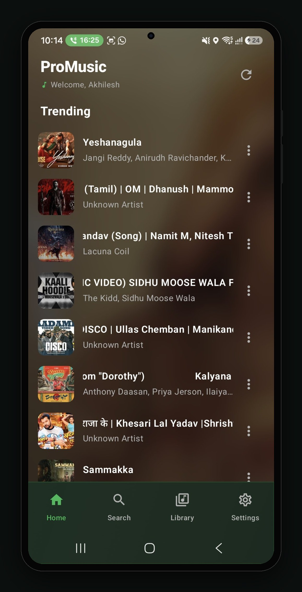
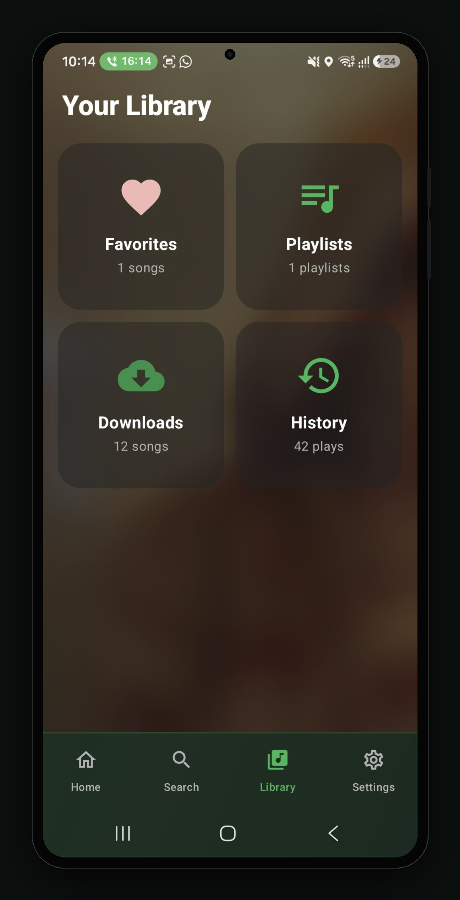
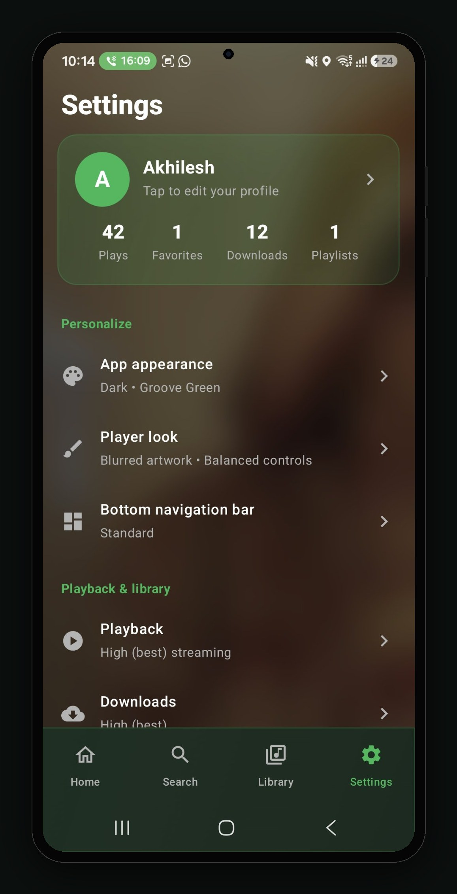
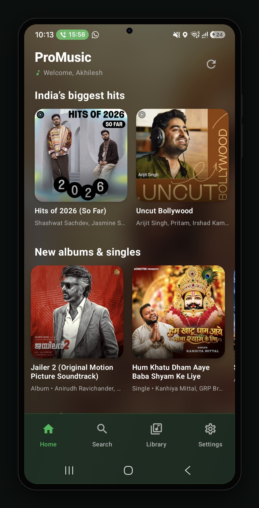

# ♪ ProMusic

**Trending music, your library, downloads and history — in one fast, dark
Android app.**

> 🌐 **Website:** https://akhilesh2412.github.io/ProMusic/
> ⬇️ **Download APK (v2.0):** https://github.com/akhilesh2412/ProMusic/releases/download/v2.0/ProMusic.apk

## Screenshots

| Home / Trending | Your Library | Settings | India's Biggest Hits |
| --- | --- | --- | --- |
|  |  |  |  |

## Features

- **Trending now** — the songs everyone is listening to, with artwork, artist
  and quick actions on every track.
- **India's biggest hits** — curated hit playlists and new albums & singles,
  from Bollywood to regional music.
- **Your Library** — Favorites, Playlists, Downloads and History, all in one
  place, with counts at a glance.
- **Downloads** — save songs for offline listening in high quality.
- **History** — every play remembered, so you can jump back to what you loved.
- **Personalize it** — Dark theme with Groove Green accent, blurred-artwork
  player look with balanced controls, and a standard bottom navigation bar.
- **High-quality playback** — High (best) quality streaming and downloads.

## Install

1. Download the APK from the
   [v2.0 release](https://github.com/akhilesh2412/ProMusic/releases/tag/v2.0)
   (or use the direct link above).
2. On your phone, allow **Install unknown apps** for your browser when asked.
3. Open the APK and install. Requires **Android 8.0 or newer**.

## App info

| | |
| --- | --- |
| Package | `com.promusic.app` |
| Version | 2.0 (versionCode 2) |
| Size | ~8.4 MB |
| Requires | Android 8.0+ |
| Network | Internet access is required to stream music |

## License

This project is currently all rights reserved.
